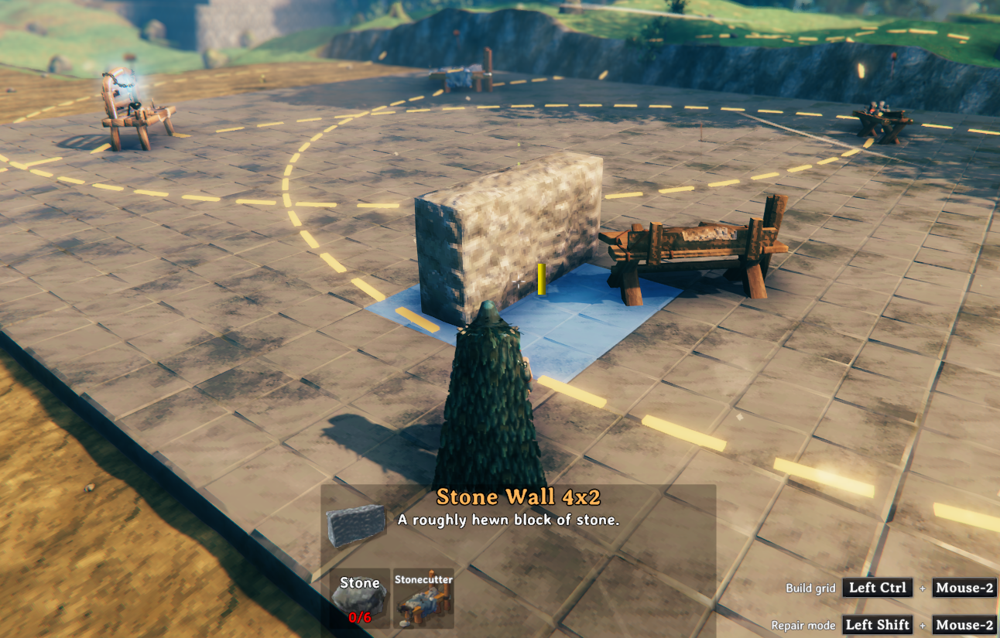
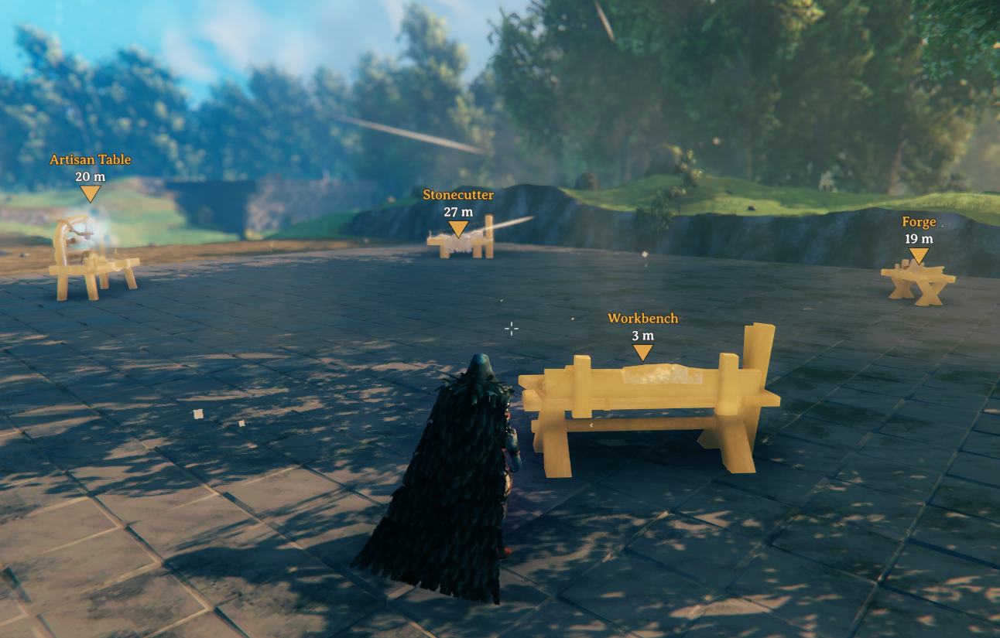

# BenchLink

Link nearby crafting stations into clusters so one of each bench covers your whole base.
Inside a cluster, every bench's build range counts for every bench type in it.

## How It Works

Two stations link when they are closer than the larger of their build ranges, and links chain into clusters.
Build anywhere inside the range of **any** station in a cluster to use every station type in it.
A cluster holds **one station of each type**, so extra benches cannot be chained outwards.
With the Hammer out, the rings of nearby benches are shown: gold if linked, white if not.
Rings lie on the floor around a bench, so they show on raised floors and platforms.

## Finding Your Benches

Press **Shift+E** on any station to light up every station in its cluster for a few seconds.

## Configuration

Settings are in the BepInEx config file `javidahmed64592.benchlink.cfg`.

## License

This project is licensed under the MIT License - see the [LICENSE](https://github.com/javidahmed64592/Valheim-BenchLink/blob/main/LICENSE) file for details.
